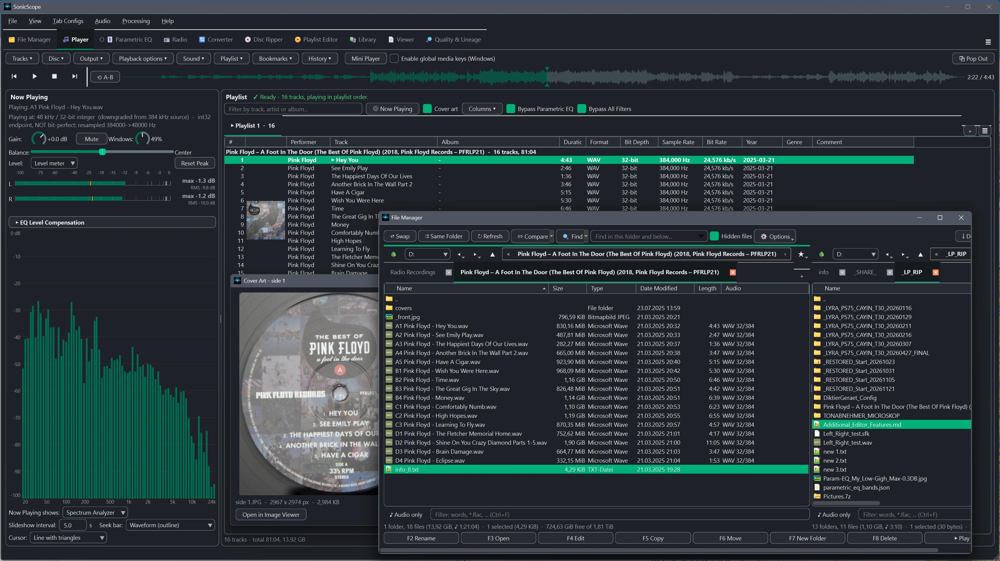

# SonicScope

A free hi-res audio player for Windows and Linux, with tools for your music collection.

**[⬇ Download the latest version](../../releases/latest)**

*Deutsch und Русский: see below.*

Up to version 1.2.5, SonicScope was called AudioCluster.

## What it does

**Player**: 

***Playback at full resolution***
- PCM files up to 768 kHz and native DSD. Which rate reaches the DAC depends on the device and driver. On Windows, WASAPI Exclusive usually ends at 384 kHz; native DSD runs there as DoP up to DSD128, and up to DSD256 if the DAC accepts a 705.6 kHz DoP carrier. On Linux, output goes through an ALSA hw device at the file's rate, as far as the DAC supports it.
- The file's rate first. The device gets the file's own rate whenever it accepts it. Otherwise the app picks the rate that loses the least: for example 88.2 → 96 kHz instead of down to 48 kHz, or 705.6 → 352.8 kHz as an exact halving. Resampling always uses the soxr resampler at its highest quality.
- Playing at shows the rate the device really plays at, noting “downgraded from” or “upsampled from” when it differs from the file.
- Bit-exact output (32-bit integer) sends a file's samples to the DAC unchanged. Any active effect that would prevent this is named in the status bar.
- Gapless: the next track is prepared in the background and takes over the open output stream sample-accurately, without releasing the device.
- Internal precision 32-bit float, 64-bit float on request. The playback buffer is adjustable from 50 to 900 ms.
  
***Output to a network player***
- Output ▾ sends the playlist to a streamer, AV receiver, TV or wireless speaker on the home network (UPnP/DLNA) instead of the PC's audio device, found by a network search or by its address.
Handled as usual: Play/Pause, Stop, Previous/Next, seeking, the queue and the running order. The position bar follows the device. Switching the output mid-track carries on at the same position, in both directions.
Unchanged where possible: a file the device can play goes to it unchanged. Anything else (another format, CD tracks, DSD, multichannel) is decoded here and sent as WAV, sample for sample, optionally converted down to a highest sample rate. The device's volume is in the menu; EQ and effects stay with the PC's output.

***Playlists and handling***
- Multiple playlists as sub-tabs. Switching between them never touches playback. Each playlist keeps its filter, queue, shuffle order and undo.
- Smart playlists fill themselves from the Library by rules: rating, play count, not heard for a long time, recently added, genre, artist, sample rate, bit depth, format and any search terms, with sort order and limit.
- Queue (Play Next), shuffle also across all playlists or by album (whole albums in random order), crossfade from 2 to 12 s on an equal-power curve, A-B loop, sleep timer, stop after this track.
- Bookmarks (Ctrl+D) belong to the file, not the playlist. Resume per track remembers where each track was last stopped. History shows what was really played.
- Filter box that also limits playback: filter to an album and Next plays only that album.
- Columns of your choice: artist, title, album, duration, format, bit depth, sample rate, bitrate (measured from file size and length), year, genre, rating, folder and more.
- Source column: reads the codec from the file's bytes, not its extension. An MP3 saved as .flac therefore shows up as ⚠ MP3 in .flac.
- Cover art spans the rows of an album. A folder with several scans runs as a slideshow, for example for a booklet.
- Mini Player, optionally always on top. Media keys also system-wide (Windows), on Linux via the desktop's media controls (MPRIS).

***Sound***
- Gain (−24 to +12 dB), balance, mute and the system volume in one place.
- Normalize per track, per album or Auto (album gain while an album plays in order, track gain otherwise), from ReplayGain tags or, where there are none, measured once to EBU R128 and remembered. With a preamp from −10 to +12 dB. A quiet transfer gets its full gain; only peaks above −1 dBFS are rounded off.
- Effects, all off by default and switchable at any time during playback: bass boost, loudness compensation (equal-loudness correction for quiet listening), limiter, stereo widening, headphone crossfeed (only the difference between the channels, only in the bass; centered sound stays exactly the same) and speed from 50 to 200 % with pitch, for example for a record transferred at the wrong speed.
- Sound profile per output device: gain, balance, effects and EQ are saved per device and switch along when the device changes, for example headphone DAC versus speaker DAC.
- EQ per album or folder: a curve that loads with the album. The previous one returns as soon as a different album plays.
- Measure EQ level match: tells you by how many dB the EQ makes the current track louder or quieter, for a fair A/B comparison.

***Displays and information***
- Level meters as peak/RMS bars with hold values or as analog VU needles, plus a spectrum analyzer with 24 bands and a dBFS scale.
- Synchronized lyrics from an .lrc file or the lyrics tag. The current line follows along, a click jumps to it.
- Listening statistics: most played tracks and albums per period, listening time per week, albums never played.
- Release info from MusicBrainz, Discogs and Wikipedia, read-only.
- Scrobbling to ListenBrainz and Last.fm, optional and off until you enable a service. Plays made offline are sent later. For Last.fm only a session key is stored, never the password.
- Track properties: format, bit depth, measured bitrate, compression, length, location.

***Discs without ripping***
- Audio CDs play straight from the drive, titled from CD-Text or MusicBrainz, gapless, with EQ and all effects. Pre-emphasis is de-emphasized as in a CD player. A scratched sector is read again instead of aborting the track.
- DVD-Video (concert and music DVDs): the audio chapter by chapter, LPCM preferred, 5.1 downmixed. Needs ffmpeg version 7 or later. Copy-protected DVDs are detected and refused.
  
**Parametric EQ**:

- 16 bands, applied live, with presets.
- 16 bands from 20 Hz to 18 kHz, each as bell, low/high shelf, high-pass, low-pass, notch or band-pass. Gain ±14 dB, Q 0.1 to 20.
- Three phase types: zero phase, minimum phase (no pre-ringing before a click, good for vinyl rips) and linear phase (FIR).
- Simple mode with tilt, bass and treble to get started. It sets the same bands, so you can refine seamlessly in Advanced mode.
- Left and right separately adjustable, per band. Solo to listen to a single band.
- Delivers column: shows what the overall curve really delivers at a band's frequency. With overlapping bands this differs from the gain you set.
- Spectrum of a file behind the curve, to aim a cut precisely at a resonance.
- Presets: built-in genre curves and your own presets, export of the band values as JSON.
- Ctrl+Shift+E toggles the EQ from anywhere for an A/B comparison. The EQ only affects playback, never files.

**Radio**: internet radio (MP3, Ogg, AAC, FLAC) with a catalog of stations, recording and scheduled recordings.

- Internet radio via MP3 (also MP2), AAC, HE-AAC and HE-AAC v2, Ogg Vorbis, Ogg Opus and lossless FLAC and Ogg FLAC (16 and 24 bit, sample for sample as the station encoded it), Icecast and SHOUTcast. On Windows, AAC is decoded by the built-in decoder, nothing to install; on Linux by ffmpeg. Through the same listening chain as the Player: gain, EQ, effects, limiter.
- Station catalog with 281 stations from 52 countries to preview and add, including Radio Paradise's four FLAC channels. Search online among about 60,000 stations at radio-browser.info by name, country and genre; only streams the tab plays are listed.
- My stations grouped by genre, import and export of playlists (.pls, .m3u). Check stations marks stations that no longer answer and offers the new address when a station has moved.
- Now playing: the track's cover or the station's logo, title, codec, bitrate, for FLAC the bit depth. The title shown is the one you hear, not the one the station is already announcing.
- Real quality: shows the station's spectrum and where its highs really end, compared with the announced bitrate. A re-encoded stream stands out, and for FLAC you see whether it is truly lossless or a lossy source repackaged.
- Even out loudness: brings every station to the same loudness (EBU R128 over the last two minutes), matching Normalize in the Player.
- Recording (R key) from the point you are hearing, or back to the start of the current title (up to about 2 minutes), unaltered, without re-encoding: one file per broadcast or one file per track, with tags and cover. FLAC stations become a .flac with the original frames.
- Scheduled recordings: once, daily or on chosen weekdays, up to 24 hours, over a connection of their own, even while you listen to something else. Recordings are for private use only.
- Recently played tracks with a filter, search in the Library and export as CSV or .m3u8.
- Scrobbling of the titles you hear to ListenBrainz and Last.fm. Control via Mini Player and media keys.

**Converter**: converts to WAV, FLAC, WavPack, DSD or MP3, without changing the sound.

- Batch conversion of everything the Player reads, whole folder trees in one pass, with several parallel worker processes.
- Target formats: WAV (automatically RF64 above 4 GB), FLAC (also beyond the Subset up to 1,048,575 Hz and 32 bits per RFC 9639), WavPack (also native DSD and hybrid), ALAC, DSD (.dsf, DSD64/128/256), MP3, AAC (needs ffmpeg), Ogg Vorbis and Opus.
- Bit-exact where possible: a lossless source without a rate change keeps every sample. Dither (TPDF) is applied only to samples that really leave the target grid. Nothing is clipped: where the level could leave the range, the peak is measured first.
- No fake resolution: rates and bit depths above the highest resolution of the sources are not even offered. A lossy source in a lossless target is flagged.
- Output level: normalize to peak or loudness (LUFS), for example −14 LUFS for a listening copy for the car.
- Tags and cover are carried over. With a shared output folder, the artist/album structure is kept. Optionally a cue sheet and a conversion report.
- Memory use does not depend on the file's length, not even for a 30-minute side at 705.6 kHz.

**Disc Ripper**: rips audio CDs to WAV or FLAC.

- Audio CDs to WAV, FLAC or WavPack, with tags.
- Accurate mode: every sector is read from the disc twice, bypassing the drive's cache, and only accepted when two reads match. Suspicious sectors are reported with their position.
- Drive offset from the bundled AccurateRip offset list, remembered per drive model, applied only when you click.
- Titles and cover from CD-Text and MusicBrainz (via the disc ID and, if needed, the track lengths). A later source never replaces what you entered yourself.
- ReplayGain (on by default): every track is measured while it is read and gets track and album gain, without a second read. The audio stays bit-exact.
- Enhanced CDs (CD-Extra) are bounded correctly, data tracks are skipped.
- Write a cue sheet, pass ripped tracks on to the Player or the Playlist Editor.
- Note: there is no check against the AccurateRip checksum database. The app says so, too.

**Playlist Editor**: creates cue sheets, splits recordings into tracks, writes tags.

- Cue sheets: create, open, edit and save them, including those from EAC. With a preview of the exact text before saving.
- Find tracks: Detect tracks from silence suggests a start at every pause in a record side. Or mark them by ear: play the source in the Player and press Ctrl+M at the first note of each track.
- Paste titles from a copied track list. Clean up titles removes track numbers, splits “Artist – Title” and fixes capitalization, with preview.
- Search online at MusicBrainz, Discogs and Wikipedia: take over artist, album, genre, year, label and titles.
- Split a recording into tracks: writes each track of a continuous recording as a file of its own, with tags and the source's cover.
- Write tags and rename files: only the tags change, the audio is not re-encoded. For large WAV files only the end of the file is rewritten, which takes a moment.
- Custom fields (such as “Mood” or “Bought at”) as REM lines in the sheet.

**Library**: a searchable database of your music folders.

- Database over your music folders, including cue-indexed recordings. Scan changes skips unchanged folders, so even a large collection stays fast.
- Search language: for example artist:"miles davis" year:1955..1965 rate>=176400 lossy:no rating>=4. Plus switches such as lossy:, dsd:, missing:, mismatch: (extension does not match content) and date terms such as played:2026-09.
- Saved searches run fresh every time. Quick views: missing files, incomplete metadata, no cover, lossy, hi-res, unrated, never played and more.
- Three views: list (grouped by album), cover grid and tree (letter › artist › album › track).
- Ratings (Ctrl+1 to Ctrl+5), custom tags and custom fields. They live only in the database and follow a file even when you rename or move it.
- Clean up: duplicates, missing files, missing covers, wrong extensions. Delete files straight from the result list, to the recycle bin.
- Export of the library as a backup for ratings and play counts.
- The Library never writes to your audio files.
  
**File Manager**: two panes, with audio tools.

- A two-pane file manager on the commander principle, with any number of folder tabs per side and one key for everything (F5 copy, F6 move, F8 recycle bin).
- Safe copying: each file only gets its name once it is complete. Free space and the FAT32 4 GB limit are checked beforehand. Copies run at low priority, so music from the same drive keeps playing.
- Compare folders (what is missing, what is newer) and compare contents byte for byte, including subfolders, to verify a backup.
- Audio only hides everything else. Columns for length and format (“FLAC 24/192”), the total length of an album in the status bar.
- Multi-rename from tags ([track] - [title]), with preview. Edit tags for a whole album.
- Archives: unpack ZIP, 7z, RAR, TAR.
- Find files in all subfolders, also in several folders and drives at once: by name, by tags (artist:floyd, year:1970-1979), by missing tags or cover, by sample rate, bit depth, lossless/lossy, length and date. - - Searches can be saved, results stored as text or CSV.
- Check audio files: FLAC and WavPack against their built-in checksum, find damaged or truncated MP3, WAV and DSD files.
- Album check: missing, duplicate or gapped track numbers, inconsistent album tags, mixed formats, missing covers or ReplayGain, with fixes.
- Duplicates by audio content: the same samples in a different container or with different tags, and the same recording re-encoded or remastered.
- Write ReplayGain tags (track and album, BS.1770) to FLAC, Ogg, WavPack, MP3, DSF, WAV, AIFF and M4A, R128 for Opus. The audio stays untouched.
- Covers for folders: embed the folder image into every file, at a size of your choice, or save an embedded cover as folder.jpg.
- Convert into the other pane with ready-made targets (FLAC, FLAC 16/44.1, WavPack, MP3 320, Opus, AAC) or the Converter's settings.
- Preview an audio file in the other pane (Ctrl+Shift+Q): spectrogram and the Quality & Lineage verdict.
- FTP, FTPS and SFTP, network shares and network drives. Passwords are never saved.
- Dispatcher: send files and folders by right-click to the Player, queue, Library, Playlist Editor, Converter or Viewer.

**Viewer**: Markdown, HTML and JSON.

- Markdown rendered as on GitHub, with outline, tables and images. JSON as a foldable tree, also JSON Lines.
- Edit and save Markdown, HTML and JSON, with a formatting bar and live preview.
- Find, zoom, automatic reload on change. The app's guides and reports open directly.

**Quality & Lineage**: checks whether a file was ever an MP3 and whether its hi-res rate is real.

***Answers one question about a file: What was it before?***
- Lossy origin: detects a file that was once MP3 or AAC, even if it is FLAC or WAV now.
- Upsampled hi-res rates: shows whether a 96 or 192 kHz file really has content above the CD range.
- Bit depth: whether 24 bits are really used or padded; for 32-bit files, integer or float, and what the lowest 8 bits contain.
- Result as a color-coded verdict with a report. Next file takes you through a whole album.
- The file is never changed.

**Formats**

- Playback	WAV, RF64, Wave64, FLAC, AIFF, WavPack, DSD (.dsf/.dff), ALAC, MP3, Ogg Vorbis, Opus, CAF; AAC with ffmpeg
- Convert to	WAV/RF64, FLAC, WavPack, ALAC, DSD (.dsf), MP3, Ogg Vorbis, Opus; AAC with ffmpeg
- Rip to	WAV, FLAC, WavPack
- Discs	Audio CD (play and rip), audio of DVD-Video (play, with ffmpeg)
- Radio	MP3/MP2, Ogg Vorbis, Ogg Opus
- Playlists	M3U/M3U8, CUE, PLS

The interface is in English, German and Russian (**View ▸ Language**). **Help ▸ Guide** (F1) explains every tab.

## Download and start

Pick a file from the [latest release](../../releases/latest):

| System | File | How to start |
|---|---|---|
| Windows 10/11, 64-bit | `SonicScope_x-y-z.zip` | Unpack it anywhere and double-click `SonicScope.exe`. Nothing is installed. |
| Linux x86_64, any distribution | `SonicScope-x.y.z-linux-x86_64.tar.gz` | Unpack it and start `SonicScope` in that folder. |
| Debian / Ubuntu | `sonicscope_x.y.z_amd64.deb` | `sudo apt install ./sonicscope_x.y.z_amd64.deb` |
| Linux, single file | `sonicscope-x.y.z-x86_64.AppImage` | `chmod +x` it, then run it. |

On Linux the system also needs `libportaudio2` (sound output) and `libwavpack1` (WavPack and DSD).

**Windows SmartScreen:** the program is not signed, so on the first start Windows may say "Windows protected your PC". Click **More info → Run anyway**. Each release lists the SHA-256 checksum of every file, so you can check that your download is the original one.

## Licence

SonicScope is free for personal, non-commercial use. You may pass it on free of charge, as long as the copy is complete and unchanged. The full terms are in [LICENSE](LICENSE).

SonicScope contains open-source components, each under its own licence. They are listed in [THIRD_PARTY_NOTICES.md](THIRD_PARTY_NOTICES.md), the licence texts are in [licenses](licenses), and every download includes both. The source code of SonicScope itself is not published.

## Problems and questions

Please open an [issue](../../issues). Say which version and system you use, and what you did before the problem appeared.

---

## Deutsch

SonicScope ist ein kostenloser Hi-Res-Audioplayer für Windows und Linux, mit Werkzeugen für die eigene Musiksammlung: Player (bis 768 kHz, natives DSD, bit-perfekt), parametrischer EQ, Internetradio, Konverter, CD-Ripper, Cue-Sheet-Editor, Bibliothek und Dateimanager. Die Oberfläche gibt es auf Deutsch (**Ansicht ▸ Sprache**).

Bis Version 1.2.5 hieß SonicScope AudioCluster.

**[⬇ Neueste Version herunterladen](../../releases/latest)**

- **Windows:** die `.zip` entpacken und `SonicScope.exe` starten. Es wird nichts installiert. Meldet Windows „Der Computer wurde durch Windows geschützt“, dann auf **Weitere Informationen → Trotzdem ausführen** klicken. Das Programm ist nicht signiert.
- **Linux:** `.tar.gz`, `.deb` oder AppImage, wie in der Tabelle oben. Zusätzlich werden `libportaudio2` und `libwavpack1` gebraucht.

Die Nutzung ist für private, nicht-kommerzielle Zwecke kostenlos. Weitergeben dürfen Sie das Programm kostenlos und nur vollständig und unverändert. Die Bedingungen stehen in [LICENSE](LICENSE).

## Русский

SonicScope — бесплатный Hi-Res аудиоплеер для Windows и Linux с инструментами для музыкальной коллекции: плеер (до 768 кГц, нативный DSD, bit-perfect), параметрический эквалайзер, интернет-радио, конвертер, риппер CD, редактор cue, библиотека и файловый менеджер. Интерфейс есть на русском (**Вид ▸ Язык**).

До версии 1.2.5 SonicScope назывался AudioCluster.

**[⬇ Скачать последнюю версию](../../releases/latest)**

- **Windows:** распакуйте `.zip` и запустите `SonicScope.exe`. Установка не нужна. Если Windows пишет «Система Windows защитила ваш компьютер», нажмите **Подробнее → Выполнить в любом случае**. Программа не подписана.
- **Linux:** `.tar.gz`, `.deb` или AppImage, см. таблицу выше. Также нужны `libportaudio2` и `libwavpack1`.

Программа бесплатна для личного некоммерческого использования. Передавать её другим можно бесплатно, только полностью и без изменений. Условия описаны в [LICENSE](LICENSE).
